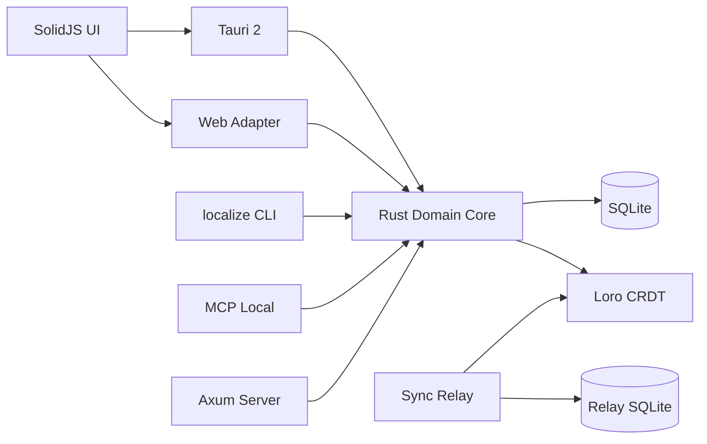

# SlimLocalize

SlimLocalize is a local-first workspace for managing internationalization,
environment configuration and developer-facing translation workflows.

Core data lives in a local SQLite database. Internet, servers and accounts are
optional. The project is MIT-licensed and avoids mandatory SaaS dependencies.

## Current status

- F0 foundation: monorepo, Rust core, SQLite, CLI, Tauri/Solid scaffold, server, Docker.
- F1 vertical slice: workspaces, projects, locales, namespaces, translation keys,
  values, import/export, placeholder checks, environments and public configuration.
- F2 preparation: tested Loro CRDT prototype and sync contracts.
- Future: authentication, ACL, sharing, remote sync, encrypted vault, MCP writes.

## Stack

- Rust, Tokio, Axum, SQLite, Loro
- Tauri 2, SolidJS, TypeScript, Vite, UnoCSS
- Bun, mise, just, Docker, GitHub Actions

## Quick start

```bash
mise trust
mise install
just doctor
just setup
just dev-desktop
```

Web preview:

```bash
just dev-web
```

EOF

## CLI

```bash
localize --version
localize doctor
localize workspace create demo
localize workspace list
localize project create demo-app
localize project list
localize locale add es-PE
localize locale add en-US
localize keys list
localize import ./fixtures/locales
localize export --format json
localize check
```

## Docker

SQLite is embedded. Docker only runs the optional read-only server.

```bash
docker compose config
docker compose build
docker compose up -d
docker compose ps
docker compose logs -f
docker compose down
```

## Tests

```bash
just test-rust
just test-web
just test-e2e
```

## License

MIT. See `LICENSE`.

## Collaboration

Bootstrap a collaborative document and exchange updates between two local peers:

```bash
localize sync bootstrap --project demo-app
localize sync export --project demo-app --output changes.loro
localize sync import --project demo-app changes.loro
localize sync status --project demo-app
localize sync inspect changes.loro
```

Run the optional relay:

```bash
just sync-up
just sync-ps
just sync-down
```

## Architecture



## Roadmap

- F0/F1: local workspace, translations, environments, CLI, Tauri, web and Docker.
- F2A: durable Loro collaboration and file-based sync.
- F2B: authenticated sharing, invitations, relay hardening and production security.
- F3: mobile hardening, web durable storage, MCP remote and agent workflows.
